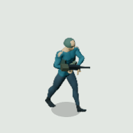
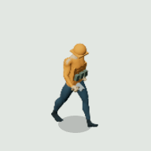
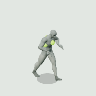
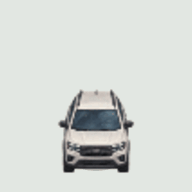

# Sprite Animation Skill

A shared Claude Code and Codex skill for producing, refining, and validating animated 2D sprite assets. It covers authored frames, segmented 2D rigs, and rigged 3D sources baked into sprite sheets, with separate visual, technical, and runtime checks.

## Delivered Examples

Final Dead Zone / Rigged Tactics sprites, enlarged for inspection. These are actual delivered frames, not concept art or newly approximated animations.

| Soldier | Builder |
| --- | --- |
|  |  |

| Walker | Spitter |
| --- | --- |
|  |  |

**White SUV: eight-view turnaround**



The vehicle has directional poses, not a wheel-animation clip. [PNG posters](examples/dead-zone/), [complete source sheets](examples/dead-zone/sheets/), [example details](references/dead-zone.md), and [provenance/source notices](examples/dead-zone/PROVENANCE.md) are included. Each humanoid source sheet retains all delivered actions and directions, beyond the walk shown here.

## Install

```bash
git clone https://github.com/asaeed/sprite-animation-skill.git ~/claude/sprite-animation-skill
cd ~/claude/sprite-animation-skill
./install.sh
```

The installer links both `~/.claude/skills/sprite-animation` and `~/.codex/skills/sprite-animation` to this checkout. It can be run from any working directory and repeated safely. Existing regular files or directories are never overwritten; move those aside deliberately before installing.

Use `/sprite-animation` in Claude Code or `$sprite-animation` in Codex. Updates from `git pull` are available through the same links without copying or reinstalling the skill.

## Contents

- `SKILL.md`: shared workflow and method selection.
- `references/production.md`: reusable production, alignment, resolution, motion, and QA methodology.
- `references/raster-sources.md`: reference-guided source preparation, prompt template, alpha extraction, and registration.
- `references/rigged-to-sprites.md`: rest-state retargeting, prop/palm contact equations, two-bone constraints, and stable baking.
- `references/lessons.md`: recorded successes, rejected experiments, and evidence limitations.
- `references/dead-zone.md`: project-specific recipes, settings, historical results, and local asset paths.
- `scripts/inspect-sheet.mjs`: decoded-pixel auditing and an HTML playback/frame-stepping review.
- `agents/openai.yaml`: Codex display metadata and invocation policy.
- `examples/dead-zone/`: five final-outcome examples, GIFs/PNG posters, source sheets, frame metadata, and provenance.

All essential instructions are in this repo. No other installed skill, original game checkout, local web server, or prior conversation is required. The short Dead Zone profile is optional example context, not a dependency. Old machine-specific paths and game-development logs have been removed from current guidance; reusable observations are retained in the lessons reference.

The skill is a production workflow, not a one-click generator that bundles every model or engine. Artwork/source models, an image tool when generating art, and a chosen 3D renderer when baking rigs are normal task inputs. Missing tools or assets must be requested or disclosed, not silently substituted.

## Sheet Inspection

The inspection/export helpers require Node.js 20 or later, the pinned Playwright dependency, and an installed Chromium browser. The installer itself only needs Bash and symlink support. Install helper dependencies with `npm ci`:

```bash
node scripts/inspect-sheet.mjs examples/dead-zone/sheets/soldier.png \
  --frames examples/dead-zone/soldier-walk.json \
  --report /tmp/sheet-audit.json \
  --preview /tmp/sheet-review.html
```

For irregular layouts, use `--frames /path/to/frames.json` instead of a grid. The helper checks transparency, blank/duplicate frames, bounds, and possible clipping. Its reports do not establish anatomical quality or visual approval.

## Rebuild the Examples

```bash
npm ci
npm run examples:render
```

This uses only the included sheets and metadata. FFmpeg must be on `PATH`; set `FFMPEG_PATH` for a different executable. Browser autodetection covers common macOS/Linux Chrome/Chromium locations; set `SPRITE_BROWSER_EXECUTABLE` when needed, including on Windows. The inspection helper also accepts `--chrome /path/to/browser`.

The README GIFs use the real sixteen-frame walk cycles and their recorded frame rates. The SUV cycles through eight static facings. Export preserves fixed anchors and uses one palette per GIF; it does not regenerate or deform the artwork. Animated GIFs display directly in GitHub's README; PNG posters are included for static use.

## Test Installation

```bash
bash -n install.sh
npm test
```

Tests use temporary home directories and do not alter your installed skills.
